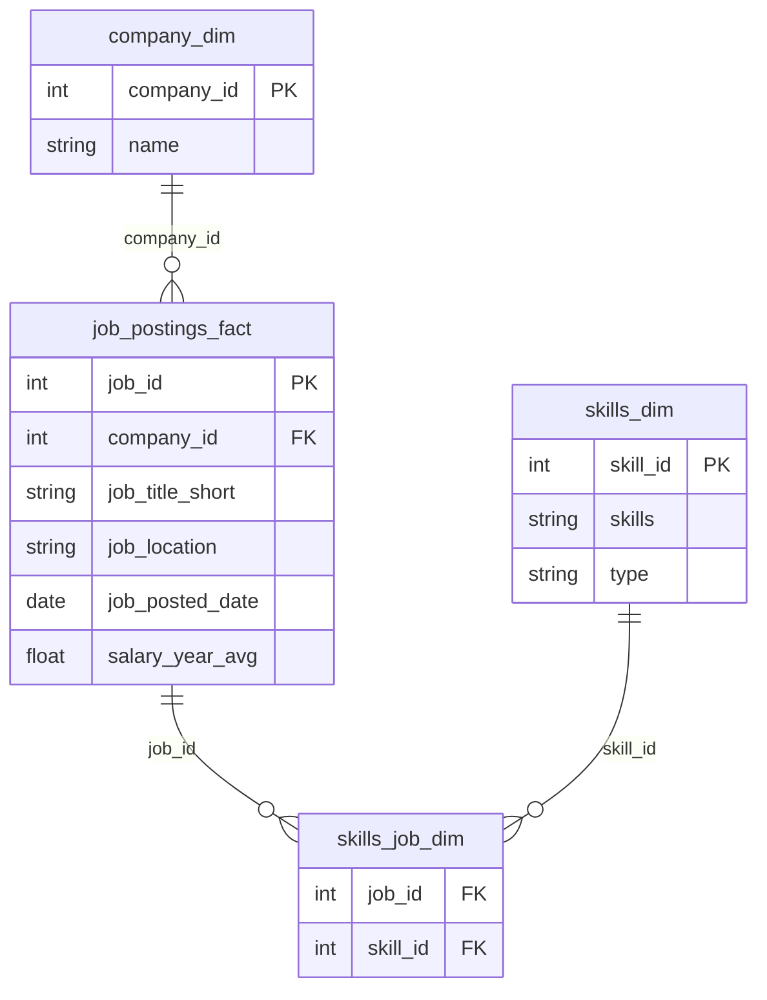
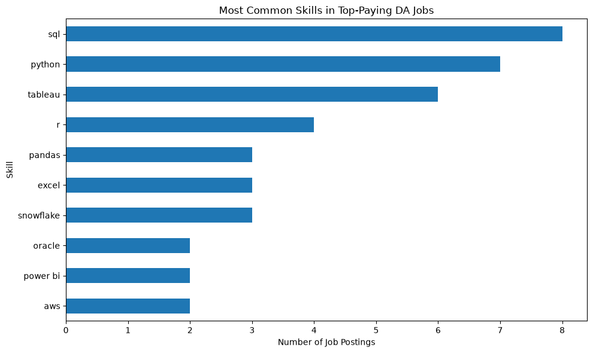
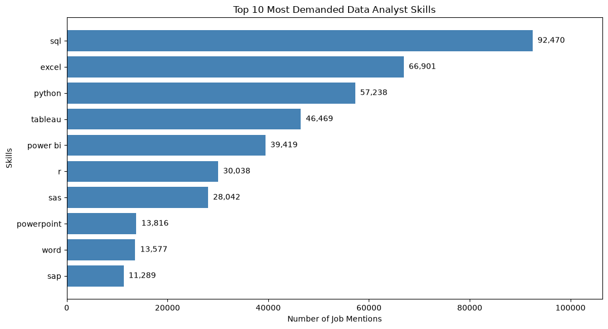
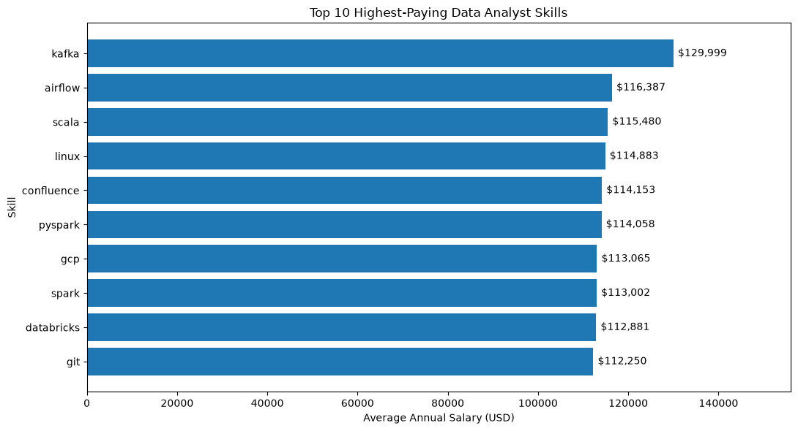
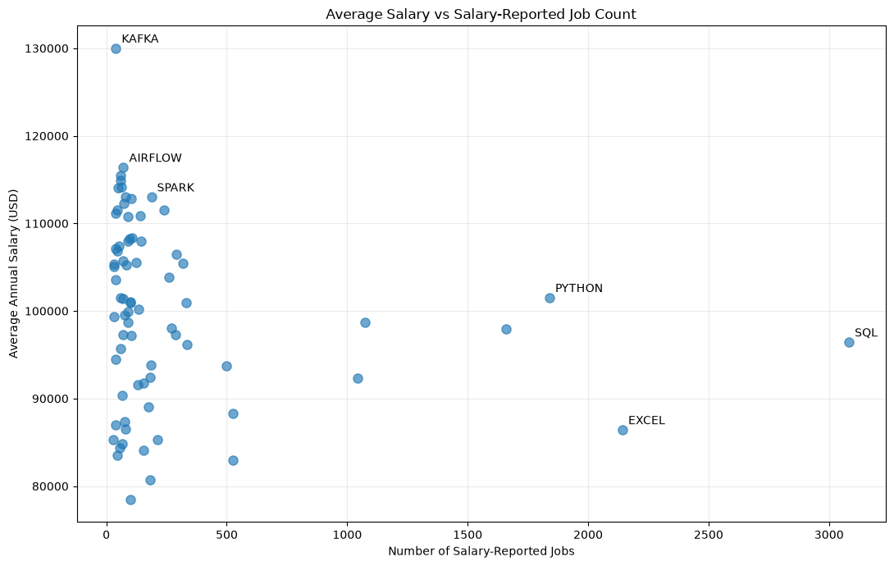
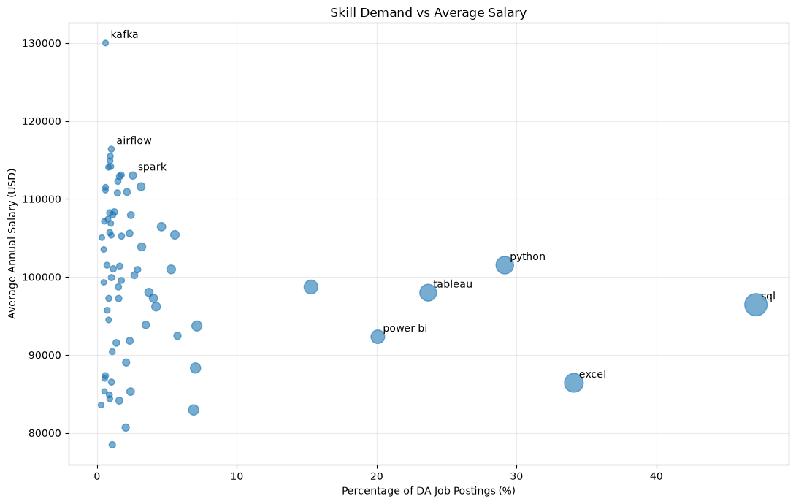

# 📊 Data Analyst Job Market Analysis | SQL & Python

**Tools:** PostgreSQL · pgAdmin 4 · Python · Pandas · Matplotlib · Jupyter Notebook

An analysis of Data Analyst job postings to identify the most in-demand skills, highest-paying remote roles, and the relationship between advertised salary and skill demand.

## 📚 Table of Contents
- [Business Task](#business-task)
- [Dataset and Relational Model](#dataset-and-relational-model)
- [Entity Relationship Diagram (ERD)](#entity-relationship-diagram-erd)
- [Questions and Solutions](#questions-and-solutions)
- [Summary of Findings](#summary-of-findings)
- [Run the Project](#run-the-project)

---

## Business Task

Job seekers face an important question: **Which skills are worth learning to improve their opportunities in the Data Analyst job market?**

A skill may appear in thousands of job postings without being associated with the highest salaries. Conversely, a specialized skill may have a high advertised salary but relatively few vacancies.

This project uses PostgreSQL and Python to investigate job demand and salary trends through five business questions.

## Dataset and Relational Model

The analysis uses job posting data containing job titles, companies, locations, annual salaries, and advertised skills.

| Table | Description |
|---|---|
| `job_postings_fact` | Job IDs, titles, locations, posting dates, annual salaries, and company IDs |
| `company_dim` | Company names and IDs |
| `skills_dim` | Skill names and IDs |
| `skills_job_dim` | Bridge table connecting job postings to skills |

**Database setup:** [Create database](sql_load/1_create_database.sql) · [Create tables](sql_load/2_create_tables.sql) · [Modify tables](sql_load/3_modify_tables.sql)

---

## Entity Relationship Diagram (ERD)

The ERD shows the primary join keys and fields used in the analysis. `skills_job_dim` connects job postings and skills.



**Note:** The diagram illustrates intended relationships; it does not independently verify database constraints.

---

## Questions and Solutions

### 1. What are the highest-paying remote Data Analyst jobs?

**SQL:** [View full query](project_sql/1_top_paying_job.sql)

**Approach:** Filter job postings to Data Analyst roles with location `Anywhere` and non-null annual salary; Join `job_postings_fact` to `company_dim` to identify employers; Sort by annual salary in descending order and return the top ten jobs.

**Answer:** The query identifies the highest advertised salaries within the remote subset. These top-paying positions are not representative of typical Data Analyst compensation because experience and employer requirements vary.

---

### 2. Which skills are required for the highest-paying jobs?

**SQL:** [View full query](project_sql/2_top_paying_job_skills.sql) · **Python:** [View notebook](notebooks/2_top_paying_job_chart.ipynb)

**Approach:** Use a Common Table Expression (CTE) to select the ten highest-paying remote jobs; Join those jobs to `skills_job_dim` and `skills_dim`; Analyze the resulting job–skill pairs in Python.

**Answer:**



The selected roles include SQL, Python, R, Excel, Tableau, Power BI, and cloud/data-platform technologies. Each job can require multiple skills, so this analysis counts **job–skill combinations**, not unique jobs.

---

### 3. What are the most in-demand Data Analyst skills?

**SQL:** [View full query](project_sql/3_top_demanded_skills.sql) · **Python:** [View notebook](notebooks/3_top_demanded_skills.ipynb)

**Approach:** Join job postings to the job–skill bridge and skill dimension; Filter for Data Analyst postings with a non-null job location; Group by skill, count mentions, and rank from highest to lowest.

**Answer:**



| Skill | Job posting mentions |
|---|---:|
| SQL | 92,470 |
| Excel | 66,901 |
| Python | 57,238 |
| Tableau | 46,469 |
| Power BI | 39,419 |

**Business insight:** SQL is the most frequently requested skill, followed by Excel and Python. Employers continue to value spreadsheet and reporting skills alongside programming.

---

### 4. Which skills are associated with the highest average salaries?

**SQL:** [View full query](project_sql/4_top_paying_skill.sql) · **Python:** [View notebook](notebooks/4_top_paying_skill.ipynb)

**Approach:** Join job postings to their associated skills; Include only postings with reported annual salaries; Calculate average annual salary by skill; Require at least 30 salary-reported postings per skill to reduce single-observation distortions.

**Answer:**





| Skill | Salary-reported postings | Average annual salary |
|---|---:|---:|
| Kafka | 40 | $129,999 |
| Airflow | 71 | $116,387 |
| Spark | 187 | $113,002 |
| Python | 1,840 | $101,512 |
| SQL | 3,083 | $96,435 |
| Excel | 2,143 | $86,419 |

**Business insight:** Specialized data engineering skills show higher average advertised salaries in this sample. However, those averages often rely on fewer postings than SQL or Python; the difference is an association, not proof that learning a particular skill causes higher pay.

---

### 5. Which skills provide the best combination of demand and salary?

**SQL:** [View full query](project_sql/5_most_optimal_skill.sql) · **Python:** [View notebook](notebooks/5_most_optimal_skill.ipynb)

**Approach:** Count distinct Data Analyst postings mentioning each skill; Divide skill-specific job counts by the total number of Data Analyst postings to calculate demand share; Calculate average salary using only postings that report annual salary; Compare demand, salary, and salary-reporting sample size.

**Answer:**



| Skill | Share of Data Analyst postings | Average advertised salary |
|---|---:|---:|
| SQL | 47.1% | $96,435 |
| Excel | 34.1% | $86,419 |
| Python | 29.2% | $101,512 |
| Tableau | 23.7% | $97,978 |
| Power BI | 20.1% | $92,324 |
| Kafka | 0.61% | $129,999 |

**Business insight:** SQL provides the broadest coverage of Data Analyst postings. Python combines substantial demand with a comparatively high observed average salary. Kafka has a higher salary average but appears in far fewer postings.

**Note:** The demand counts in question 3 exclude postings with null locations, while this comparison uses all Data Analyst postings. Their denominators differ.

---

## Summary of Findings

1. **SQL leads demand:** It appears in approximately 47.1% of Data Analyst postings in the overall-demand analysis.
2. **Excel remains important:** Spreadsheet skills appear frequently alongside SQL and Python.
3. **Python offers a strong demand–salary combination:** It is widely requested and has a higher observed salary average than several common BI tools.
4. **Specialized skills have a different trade-off:** Kafka, Airflow, and Spark are associated with higher salaries but generally smaller salary-reporting samples or narrower demand.
5. **Sample size matters:** Salary averages reflect only advertisements with disclosed annual compensation.

## Run the Project

1. Install PostgreSQL and pgAdmin 4.
2. Run the scripts in [`sql_load/`](sql_load/) in numbered order and load the source job-posting CSVs.
3. Execute the five SQL analyses in [`project_sql/`](project_sql/).
4. Export SQL results to CSV as needed for the notebooks.
5. Install Python dependencies and open the notebooks:

```bash
pip install pandas matplotlib jupyter
jupyter notebook
```

6. Update notebook input paths to point to your local SQL exports.

**Project files:** [SQL analyses](project_sql/) · [Python notebooks](notebooks/) · [Database scripts](sql_load/) · [Charts](assests/)

The original chart files remain in `assests/`; the folder name is preserved so existing image links continue working.

---

**Repository:** [ChrisVu16-git/SQL_Projects](https://github.com/ChrisVu16-git/SQL_Projects)
