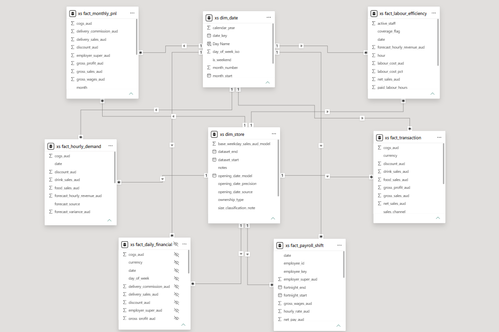
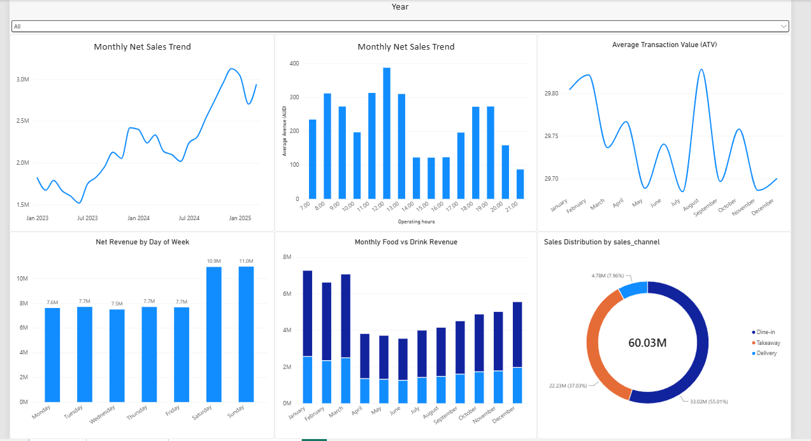
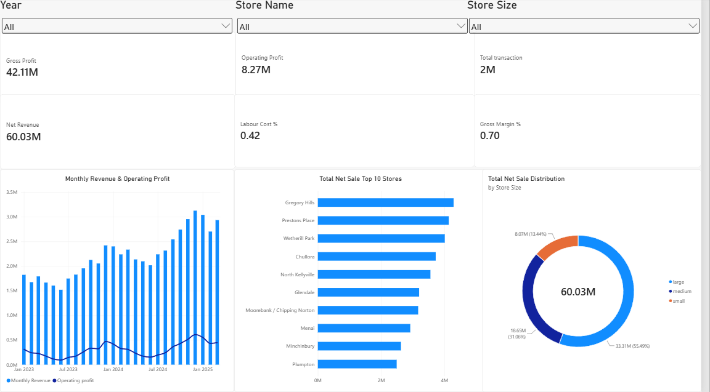
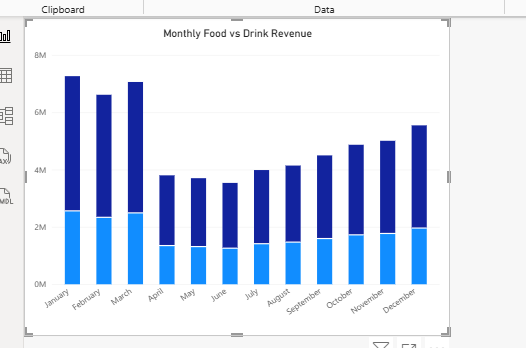
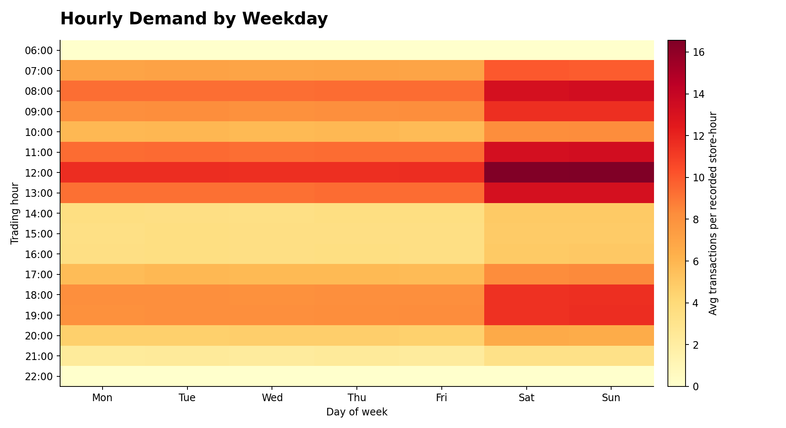
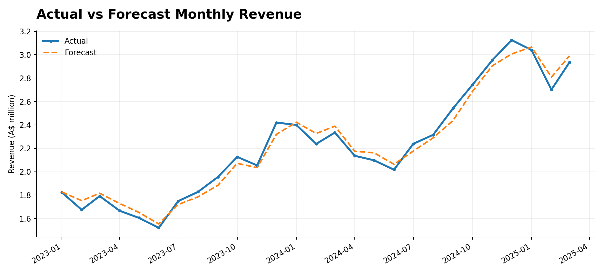
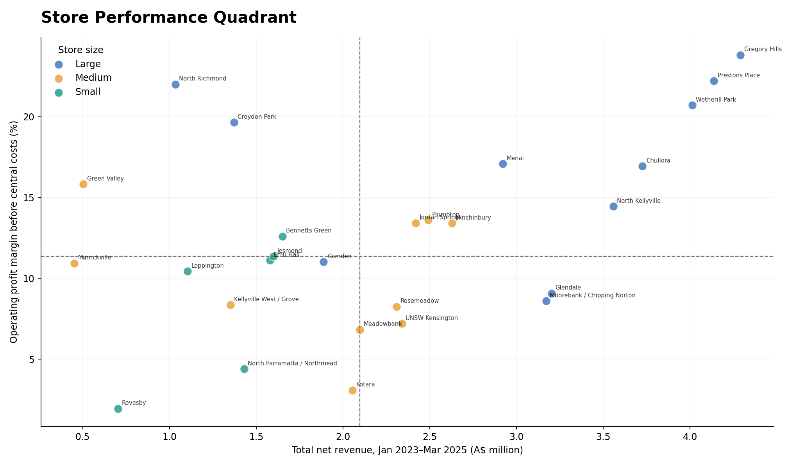

# XS Espresso | Sales, Demand & Operational Analytics

**Tools:** PostgreSQL · SQL · Power BI · DAX · Python

## 1. Project Overview

This project examines sales trends, hourly customer demand, forecast accuracy, store-level profitability, and operational decision-making across XS Espresso locations, covering January 2023–March 2025. It connects transaction, hourly demand, financial, and labour data through a Power BI dimensional model.

**Core questions:** When is customer demand highest? How reliable are hourly revenue forecasts? Which stores combine strong revenue with healthy operating margins?

> Data provenance: This is a portfolio dataset generated for analytical demonstration, not an official company financial statement.

## 2. Entity–Relationship Diagram (ERD)

The Power BI model uses two shared dimensions, `dim_date` and `dim_store`, related one-to-many to six fact tables:

| Table | Analytical grain |
|---|---|
| `fact_transaction` | Transaction |
| `fact_hourly_demand` | Store × date × hour |
| `fact_daily_financial` | Store × date |
| `fact_monthly_pnl` | Store × month |
| `fact_labour_efficiency` | Store × date × hour |
| `fact_payroll_shift` | Employee × shift |

Relationships use date and store identifiers, with dimensions filtering facts. The diagram below is the Power BI relationship view for the analytical model. It illustrates the shared date and store dimensions and the relationships used to analyse transactions, demand, finance, labour, and payroll at different grains.



[Open full-size ERD](screenshots/data_model_relationships.png) · [ERD source (Mermaid)](docs/ERD.mmd)

> **Model consideration:** The monthly P&L fact has a different date grain from daily facts; month-level reporting should use an appropriate month key or date strategy rather than assuming that every daily date filters a month-start column identically.


## 3. Power BI Dashboard

The Power BI report includes an Executive Overview and Sales Performance views covering network sales, gross margin, operating profit, labour cost, store rankings, hourly revenue, weekday revenue, channel mix, and food/drink revenue.

The three analytical visualisations—**Demand Heatmap**, **Actual vs Forecast**, and **Store Performance Quadrant**—were produced separately and are not embedded in the original PBIX.

### Monthly Sales Distribution



This view summarises the sales distribution over time, providing a starting point for examining seasonal patterns and changes in network performance.

### Revenue Dashboard



### Food vs Drink Sales



**Power BI data model:** See the [ERD screenshot in Section 2](#2-entityrelationship-diagram-erd).

**Download the Power BI report:** [XS_Espresso_Dashboard.pbix](dashboard/XS_Espresso_Dashboard.pbix)

The dashboard screenshots are committed to this repository. The Power BI report is the original dashboard file; the three featured analytical figures in Section 6 are separate visuals, not additional report pages.

## 4. Business Questions

1. **Demand:** Which weekday/hour combinations create the greatest pressure on operations?
2. **Forecasting:** Does an accurate aggregate forecast also perform well at the hourly level?
3. **Store performance:** Which stores have strong sales but relatively weak profitability?

## 5. Data Preparation and Validation

The PostgreSQL `xs` schema holds the dimensional model and financial fact tables. Analysis should reconcile transaction net sales to daily and monthly summaries within consistent reporting periods. Revenue, gross profit, labour costs, and operating profit are kept distinct to avoid mixing metrics from different grains.

Checks include uniqueness of store/date/hour keys, missing values, invalid trading hours, duplicate transactions, and revenue reconciliations. Monthly P&L is not added to transaction facts because that would double-count financial metrics.

## 6. SQL Analysis and Findings

The accompanying [SQL analysis](sql/portfolio_analyses.sql) reproduces three portfolio investigations.

### Hour × Weekday Demand



**Method:** Group store-hour observations by ISO weekday and hour. Use `SUM(transactions) / COUNT(*)` to calculate average transactions per recorded store-hour, including zero-transaction observations.

**Interpretation:** High-demand cells highlight likely service bottlenecks. These are candidates for reviewing roster overlap, preparation and kitchen coverage—not automatic evidence that staffing is inadequate.

### Actual vs Forecast Revenue



**Method:** Compare `net_sales_aud` against `forecast_hourly_revenue_aud` at the store-hour grain. Calculate weighted absolute percentage error:

```text
WAPE = SUM(ABS(actual - forecast)) / SUM(ABS(actual)) × 100
```

**Finding:** Prior project analysis reported approximately **A$60.03M** actual net revenue and **34.34% store-hour WAPE**. Confirm the exact figures against the final exported dataset before publication.

**Interpretation:** Forecast totals can nearly cancel out while individual store-hours remain inaccurate. Therefore monthly totals alone are insufficient for workforce scheduling decisions.

### Store Performance Quadrant



**Method:** Aggregate each store's net revenue and operating profit before central costs. Calculate operating margin and split stores at the median revenue and margin.

**Interpretation:** High-revenue/low-margin stores warrant cost-driver investigation; low-revenue/high-margin stores may have effective cost discipline worth studying. These segments are exploratory, not causal explanations.

## 7. Data Storytelling — From Patterns to Decisions

### Story 1 — Demand is uneven throughout the trading day

**Business context:** Uniform staffing across trading hours can mismatch customer traffic.

**Evidence:** A weekday-by-hour matrix highlights recurring demand peaks and quieter periods.

**Interpretation:** A high transaction count indicates workload concentration; it does not, on its own, establish poor service levels or insufficient staffing.

**Decision supported:** Compare the heatmap with actual staff coverage and transaction throughput. Test whether reallocating shift overlap improves productivity without reducing service quality.

### Story 2 — A forecast can look accurate in total and still fail operationally

**Business context:** Store managers need accurate demand expectations at the hour when staffing decisions are made.

**Evidence:** Aggregate revenue and forecast may be close, yet the store-hour WAPE can remain material.

**Interpretation:** Positive and negative errors offset at monthly level. The operational cost of forecasting error depends on the hour, location and staffing response.

**Decision supported:** Track forecast error by store, weekday and hour; benchmark a seasonal baseline; and evaluate forecast performance on future held-out periods before using it for roster planning.

### Story 3 — Revenue leadership does not guarantee operational efficiency

**Business context:** High-sales stores can absorb higher occupancy, labour or delivery costs.

**Evidence:** Plot each store by revenue and operating margin, with median lines dividing four quadrants.

**Interpretation:** Stores above the revenue median but below the margin median are priorities for diagnostic review, not automatically underperforming managers.

**Decision supported:** Compare labour percentage, occupancy, COGS, delivery commission and store size before recommending interventions.

### Combined narrative

**Customer demand → Forecast reliability → Staffing decisions → Store profitability.** These are connected management questions, not proof of causation. The analysis identifies where to investigate and what to test next.

## 8. Skills Demonstrated

- **SQL/PostgreSQL:** multi-grain aggregation, data quality checks, reconciliation, analytical queries
- **Power BI/DAX:** star schema, relationships, filter context, KPI and trend visualisation
- **Python:** charting and exploratory analysis
- **Business analysis:** forecasting evaluation, demand segmentation, operational interpretation and recommendations

## 9. Scope and Next Steps

The dataset covers **January 2023–March 2025**, so 2025 is a partial year. Comparisons must use like-for-like periods. Food/drink allocation is modelled rather than observed item-level sales. Future work could validate forecast models out-of-sample and test demand-adjusted labour scheduling.

**Project assets:** [Power BI dashboard](dashboard/XS_Espresso_Dashboard.pbix) · [Screenshots](screenshots/) · [SQL analyses](sql/portfolio_analyses.sql) · [SQL schema](sql/01_schema.sql) · [Data quality checks](sql/03_quality_checks.sql) · [KPI views](sql/05_kpi_views.sql) · [ERD source](docs/ERD.mmd).
